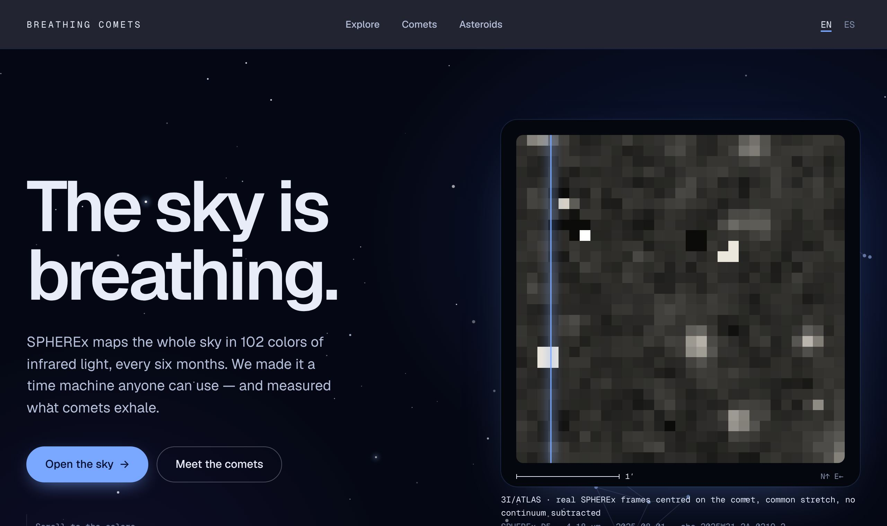
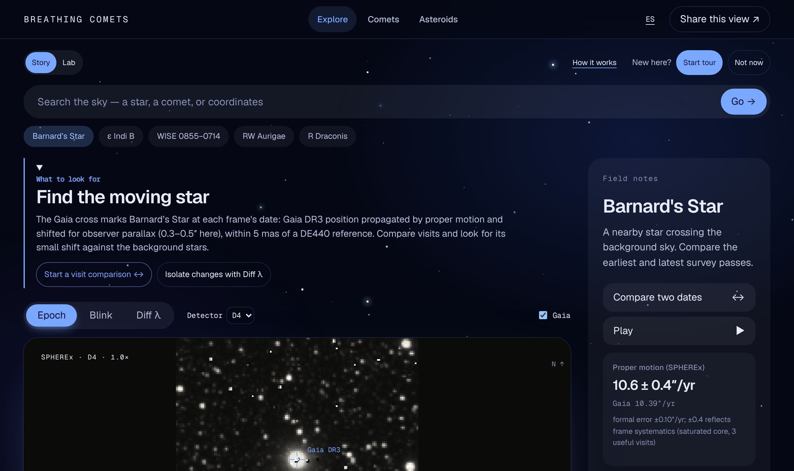
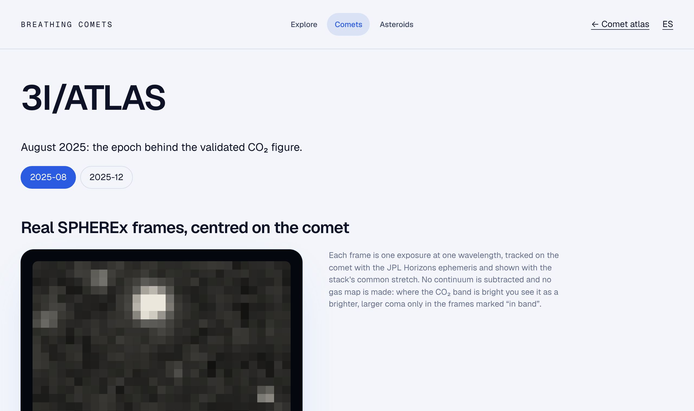
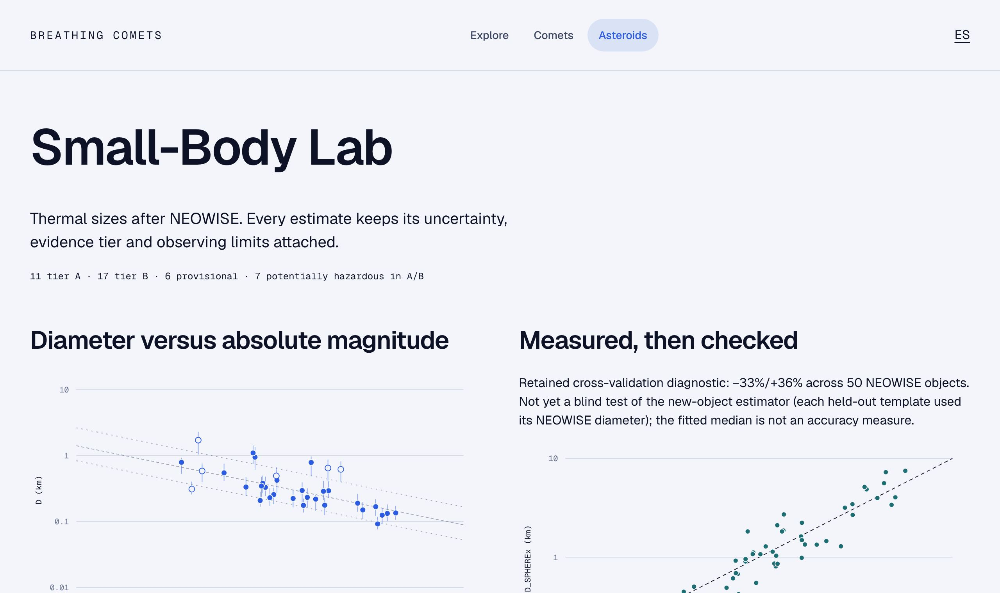
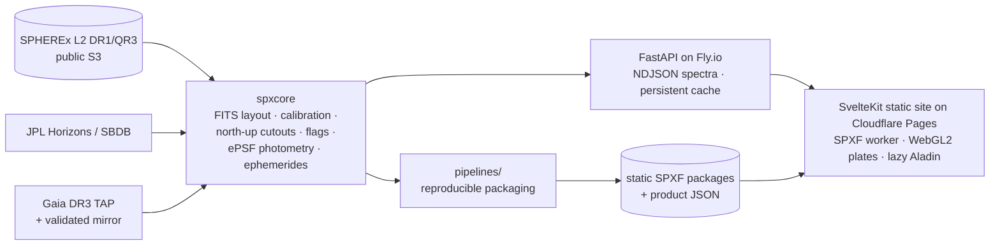

# Breathing Comets

**A public time machine for the SPHEREx infrared sky.** Play real exposures,
blink two dates, subtract the sky at matched wavelengths and click any position
for a measured spectrum. Then follow the same data to comets that exhale CO₂ and
to near-Earth asteroids sized after NEOWISE. English and Spanish throughout.

NASA Space Apps Challenge 2026 · Challenge **“Planet X and SPHEREx”** (advanced) ·
Team **Breathing Comets**, Duitama virtual site.

| | |
|---|---|
| **Live application** | https://breathingcomets.org ([Español](https://breathingcomets.org/es)) |
| **Sky Explorer** | https://breathingcomets.org/explore?target=barnard |
| **Comet atlas** | https://breathingcomets.org/comets |
| **Small-Body Lab** | https://breathingcomets.org/neo |
| **Method and limitations** | https://breathingcomets.org/method |
| **Credits and sources** | https://breathingcomets.org/about |
| **Public API** | https://api.breathingcomets.org/v1/health |



---

## Contents

1. [The challenge and how we answer it](#1-the-challenge-and-how-we-answer-it)
2. [What you can do](#2-what-you-can-do)
3. [Results on the five challenge targets](#3-results-on-the-five-challenge-targets)
4. [Comets and asteroids: the science extensions](#4-comets-and-asteroids-the-science-extensions)
5. [How it works](#5-how-it-works)
6. [Validation and evidence](#6-validation-and-evidence)
7. [Known limitations](#7-known-limitations)
8. [Run it locally](#8-run-it-locally)
9. [Repository map](#9-repository-map)
10. [Data, credits and licence](#10-data-credits-and-licence)

---

## 1. The challenge and how we answer it

> *“Create a public-facing web tool to display images of the sky from the SPHEREx
> mission, making it easy for anyone to quickly see how they change over time.”*

Pluto was found by comparing two photographs of the same sky. SPHEREx photographs
the whole sky in 102 infrared colours every six months, and is especially
sensitive to hydrogen, water, CO₂ and CO. Breathing Comets turns those images into
something anyone can blink, compare and measure.

| Requirement or optional goal | Where it lives in the product |
|---|---|
| Enter RA/Dec | Search bar accepts coordinates, star names (SIMBAD) and comet/asteroid designations (JPL) |
| Show a region as a short video | Timeline with play/pause, visits grouped by date, north-up frames |
| Spot moving objects | **Blink** A↔B, **Diff λ** matched-wavelength subtraction, Gaia DR3 marker propagated to each frame's epoch (proper motion + observer parallax) |
| Five test targets | Barnard's Star, ε Indi B, WISE 0855−0714, RW Aurigae and R Draconis are precomputed for six detectors each, with guided field notes |
| C1 – easy to update | Exposure index rebuilt from the public S3 bucket; DR1 and QR3 collections are served without code changes |
| C2 – 102 bands, co-adding, on-the-fly spectra | Cube mode with the real DR1 HiPS spectral cube in Aladin; detector stacks; **one-click forced-ePSF spectrum** streamed from the API |
| C3 – add or subtract epochs | Diff λ against other visits at compatible wavelengths |
| C4 – selectable field of view | `fov` from 0.05° to 0.5° |
| C5 – Gaia and WISE overlays | Epoch-aware Gaia DR3; AllWISE and 2MASS layers in Aladin |
| C6 – coordinates in the URL, embeddable | The full view state is in the URL; `/embed` route |
| C7 – metadata and contamination flags | Pixel and flag inspector, frame properties, link to the original FITS file |
| C8 – Astropy and Aladin | Backend on Astropy + reproject; Aladin Lite 3.8.2 |
| Molecules named in the challenge | Comet atlas measures CO₂ and CO band emission with full diagnostics |

## 2. What you can do

### Sky Explorer (`/explore`)



- **Story mode.** Pick a prepared target or search the sky. Each field explains
  *what to look for* and offers a one-tap visit comparison or Diff λ.
- **Epoch / Blink / Diff λ.** Play every exposure on a time ruler; blink the
  longest baseline within one band width; subtract other visits at compatible
  wavelengths. Every frame keeps its detector, wavelength, date, observation ID and
  source.
- **Lab mode.** Pixel and quality-flag inspector, link to the original FITS,
  one-click forced-ePSF spectrum (≥ 50 points streamed as NDJSON) and a lazy-loaded
  Aladin Lite viewer with the real DR1 spectral cube, Gaia and 2MASS layers.
- **Share and embed.** “Share this view” serializes the exact observation; a fresh
  browser restores it. Sharing is enabled only when the acquisition that matches
  the requested field is complete.
- **Works offline from the API.** The five prepared targets and the tracked comet
  plates ship as static SPXF packages and keep working if the live API is down
  (covered by an E2E test that blocks the API).
- **Guided tour** offered, never forced; keyboard-operable; English and Spanish.

### Comet atlas (`/comets`) and detail pages



20 comets with CO₂/CO band measurements, each with its status (detection,
measurement with systematics, marginal), 16–84 % interval, S/N, fractional flux
error, number of band-core channels and reduced χ². Detail pages for **3I/ATLAS**
and **29P/Schwassmann–Wachmann** show real Horizons-tracked plates ordered by
wavelength, measured spectra, diagnostics and provenance.

### Small-Body Lab (`/neo`)



Thermal-size estimates for near-Earth asteroids discovered after NEOWISE ended,
each with its interval, evidence tier, ±35 % systematic floor and single-visit
warning, plus a D-versus-H chart and the full NEOWISE cross-validation plot.

### Method (`/method`) and About (`/about`)

Ten data-driven method sections (every table is read from the shipped JSON),
explicit limitations, full source credits, and a statement on AI use.

## 3. Results on the five challenge targets

All values below are displayed in the product with their caveats and were
recomputed from the shipped data files in the
[final numerical audit](docs/audits/final-2026-11-15/README.md).

| Target | What SPHEREx shows | Reference | Caveat kept in the product |
|---|---|---|---|
| **Barnard's Star** | Proper motion **10.6 ± 0.4″/yr** | Gaia 10.39″/yr | Formal error ±0.10″/yr; ±0.4 reflects frame systematics (saturated core, 3 useful visits). Parallax not measurable. |
| **ε Indi B** | Proper motion **4.75 ± 0.04″/yr**; differential parallax **271 ± 20 mas**; methane ratio 5.4× | Gaia DR3 4.68″/yr, 270.7 mas | Per-visit bootstrap (9 visits); dropping one control star gives 277–294 mas. Ba/Bb orbit not modelled. |
| **WISE 0855−0714** | ≈ 0 below 3.8 µm (deblended from a Gaia star 6.8″ away); synthetic W2 **0.45 ± 0.02 mJy** | Published W2 13.89 mag (0.48 mJy); CatWISE2020 0.51 mJy | 14 % of the W2 band lies beyond SPHEREx's 5.0 µm limit (tail sensitivity 0.41–0.49 mJy). |
| **R Draconis** | Variability timescale **≈ 229 d (225–241)**; amplitude 2.0 mag (0.9 µm) → 0.7 mag (4.4 µm) | Catalogued period 245.6 d | Only 1.9 cycles observed; frequency resolution ≈ 123 d, so this is consistency, not an independent period. |
| **RW Aurigae** | 2025-09 → 2026-09: optical ×1.8, 4–5 µm ×0.5 (anti-correlated) | SPLICES ice target (Class II YSO) | Three epochs only. |

## 4. Comets and asteroids: the science extensions

**Comets that breathe CO₂.** For 3I/ATLAS in August 2025 the product reports
Q(CO₂) = **1.17 × 10²⁷ s⁻¹** (16–84 %: 0.86–1.38 × 10²⁷), reproduced from the
sky-subtracted D5 spectrum with a physical band model. It agrees with the
preliminary published 0.94 × 10²⁷ s⁻¹ and lies **below** the updated
1.6 × 10²⁷ s⁻¹ ± 10 % (Lisse et al. 2025, 2026); the product states this plainly.
For 29P, Q(CO) = **4.5 × 10²⁸ s⁻¹** lies inside the published 2.9–5.6 × 10²⁸ s⁻¹
range. Both are *consistency checks*, not independent discoveries. The December
3I fit carries its poor-fit caveat; a plate taken in the CO₂ band is labelled as a
band image, never as a gas map; an unsupported August H₂O comparison is withheld.

**Asteroid sizes after NEOWISE.** From 86 candidates the catalog publishes
**11 tier-A and 17 tier-B diameters (7 potentially hazardous) plus 6 provisional
entries**; no tier-C result is published. NEATM calibration uses η = 1.48 ± 0.44.
A retained cross-validation diagnostic against **50 NEOWISE objects** gives
−33 % / +36 % dispersion (p16/p50/p84 = 0.672/1.019/1.358); because each held-out
template used its own NEOWISE diameter, this is labelled a diagnostic, not a blind
accuracy test. Example: 2025 YH5, D = 0.949 km (0.610–1.363), tier A, single visit,
low inferred albedo flagged “check H”.

## 5. How it works



**Scientific core (`packages/spxcore`).** Resolves canonical public-S3 keys from an
index of **809,593 exposures**; reads the physical FITS layout (raw and
RICE-compressed, only the required extensions); uses the full-resolution spectral
calibration (`cal-swcs-v5`) for all 102 channels (0.753–4.988 µm); reprojects
north-up cutouts with Astropy/reproject; applies the official flag mask; samples
visits across time; chunks Horizons ephemeris requests; and fetches large reference
tables in validated byte ranges keyed by ETag.

**One-click spectra.** Sampled normalized effective PSF, weighted amplitude-plus-
background fit, header pixel solid angle and official photometry mask, no aperture
correction. Clicked stars are matched at the displayed epoch before the spectrum
request. Calibration ratios against 41 reference stars: J 0.982, H 1.008,
Ks 1.011, W1 0.972, W2 0.996; three live-API stellar spectra passed ±5 % checks in
Ks and W2.

**API (`services/api`, `https://api.breathingcomets.org/v1`).**
`/health`, `/resolve`, `/exposures`, `/stack`, `/diff`, `/spectrum` (NDJSON
stream), `/gaia`, `/known` and `/fits`, all with bounded query parameters. One warm
Fly machine with an encrypted 5 GB cache.

**Frontend (`apps/web`).** Svelte 5 / SvelteKit static build; a Comlink worker
decodes the custom SPXF binary progressively into R32F/R16UI WebGL2 texture arrays;
uPlot spectra; Aladin Lite imported only in Lab mode; Paraglide i18n with `/es`
prefix; initial landing JavaScript ≈ 76 KB gzip (budget 90 KB).

## 6. Validation and evidence

Nothing is counted as passing unless it was observed. Raw outputs are retained in
[`docs/verification/`](docs/verification) and the history in
[`docs/STATUS.md`](docs/STATUS.md).

| Check | Result | When |
|---|---|---|
| Production browser suite (Playwright, Chromium, 13 spec files) | **65 / 65 passed** (2.6 min) against https://breathingcomets.org | Re-run 2026-11-15 |
| Python acceptance (offline) | **202 passed, 1 known failure** (R Dra D6 baseline, see §7), 9 network tests deselected | Re-run 2026-11-15 |
| Python real-network suite (S3, IRSA, Horizons) | 9 / 9 passed | Recorded in STATUS.md |
| Frontend unit tests (Vitest) | **58 / 58 passed** (incl. parallax vs Astropy/DE440, ≤ 4.67 mas) | Re-run 2026-11-15 |
| Type check (`svelte-check`) | 0 errors, 0 warnings | Re-run 2026-11-15 |
| Production build | passes | Re-run 2026-11-15 |
| Numerical audit of every displayed figure | **33 PASS, 0 FAIL, 13 NOTE** | [audit](docs/audits/final-2026-11-15/README.md) |
| Original reference assertions | all 25 retained unchanged (30 total) | AST comparison |
| Mobile Lighthouse, landing | Performance 98 · Accessibility, Best Practices, SEO 100 · LCP 1.17 s · CLS ≈ 0 | [performance.json](docs/verification/performance.json) |
| Live API health | HTTP 200, `ok: true`, 809,593 rows, DR1 + QR3 | 2026-11-15 |

The browser suite covers real API clicks, Aladin frame 85, all five targets with
the API blocked, iPhone playback and sharing, restored URLs, language switches,
keyboard-only tour, NEO intervals and script-disabled readability.

Defects found and fixed during the build (Horizons URI truncation, 29P
designation, CORS for tests, NaN wavelength at saturated pixels, visit-sampling
edge case, hydration races, stale locale state, Gaia mirror recovery, observer
parallax) are documented with evidence in [`docs/FINDINGS.md`](docs/FINDINGS.md).

## 7. Known limitations

Stated here and on the method page, never hidden:

- **R Draconis D6 coverage** ends 2026-06-12; the internal acceptance target of a
  September baseline fails and is reported as failing.
- **Cold arbitrary fields** can take longer than the 4 s goal (observed 2–22 s on
  first acquisition); prepared targets and warm fields are fast.
- **JPL Small-Body Identification** can time out; it is shown as unavailable, never
  as an empty result.
- **No continuum-subtracted gas maps** are produced; band images are labelled as such.
- The NEOWISE comparison is a **diagnostic, not a blind test**; asteroid sizes carry
  a ±35 % systematic floor.
- No alerts or planetary-defence decisions are issued.

## 8. Run it locally

Requires **Node 24 / npm 11** (the lockfile is not accepted by `npm ci` on npm 10)
and **Python 3.13** with [uv](https://docs.astral.sh/uv/).

```sh
uv sync --frozen
cd apps/web
npm ci
npm run dev          # uses the public API by default
```

Run the backend from the repository root (uses the exposure/key indices in `data/`):

```sh
make api             # granian on http://127.0.0.1:8000
```

Set `VITE_API_BASE=http://127.0.0.1:8000` when building or starting the frontend to
use it. API caches go to `data/cache`.

### Verify

```sh
uv run pytest                  # offline acceptance
uv run pytest -m network       # real S3/IRSA/Horizons
cd apps/web
npm run check                  # run check, vitest and build sequentially
npx vitest run tests
npm run build
npx playwright test --trace off
PLAYWRIGHT_BASE_URL=https://breathingcomets.org npx playwright test --trace off
```

## 9. Repository map

```
apps/web/            SvelteKit app: routes (/, explore, comets, neo, method, about, embed, aladin),
                     WebGL2 viewer, SPXF worker, Paraglide i18n, Vitest and Playwright suites
packages/spxcore/    scientific core: s3, index, fitsio, calib, cutout, flags, psf,
                     spectrum, sky, ephem, comets, known, spxf
services/api/        FastAPI app, Dockerfile and fly.toml
pipelines/           reproducible packaging: targets, diffs, comets, NEO references,
                     landing media, build info, submission text
data/                retained exposure/S3-key indices and derived measurements
tests/               Python acceptance, contract, numerical and network tests
docs/                BUILD guide, STATUS log, FINDINGS, audits, verification outputs,
                     demo script and submission text
```

## 10. Data, credits and licence

- **SPHEREx** L2 DR1/QR3 images and the DR1 HiPS spectral cube: NASA/JPL-Caltech/IRSA.
- **Gaia DR3**: ESA/Gaia/DPAC. **2MASS**, **WISE/AllWISE**, **NEOWISE**: via IRSA/IPAC.
- **Horizons, SBDB, Small-Body Identification**: NASA/JPL. **SIMBAD, Aladin Lite**: CDS, Strasbourg.
- Comparisons: Lisse et al. 2025 (RNAAS) and 2026 (ApJL 1000, L52) for 3I/ATLAS;
  Bockelée-Morvan et al. 2022 for 29P. Astropy Collaboration 2022; reproject.

Sky plates are real mission data; the interface's decorative starfield is separate
and never presented as an observation. This is an independent Space Apps project,
not a NASA product, and uses no NASA logo.

**Use of AI.** AI-assisted tools were used for software implementation, debugging,
documentation and test preparation. Scientific statements are tied to retained
measurements, catalogue values or cited publications, and the numerical audit
re-derives every displayed figure.

Project code: **GNU GPL v3** ([LICENSE](LICENSE)). Third-party code, fonts and data
keep their own terms: [THIRD_PARTY_NOTICES.md](THIRD_PARTY_NOTICES.md).
